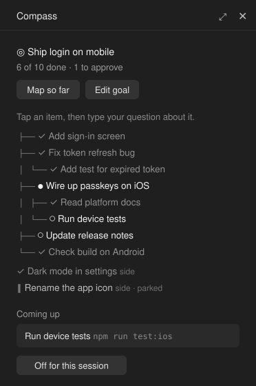

# Compass

A mod for Claude Code that keeps a long session on its goal and saves you from reading long text. It maps the session as threads of work, and you can tap any thread to ask Claude about it, like replying to one message in a chat.



*(This is a demo session, not a real project.)*

## Reply to any thread on the map

Tap an item on the map, then type. It works like replying to one message in a chat thread: Claude knows which piece of work you mean, even if it came up an hour ago and the conversation has moved on.

- No need to re-explain or scroll back. Tap **Fix token refresh bug** and ask *"why did this break?"*, and Claude answers about that fix.
- Follow-up work goes under the item you tapped. Tap **Wire up passkeys on iOS** and say *"also add Android"*, and the new work shows on the map as a child of that item, so related work stays together.
- Your message stays short. Compass adds a hidden line naming the selected item; you just type the question.

## What it does

- **Goal band.** A one-line goal and a progress count (done / total, how many steps wait for approval) sit above the prompt.
- **Map pane.** The work so far, drawn as a tree. **Stem** items are steps toward the goal. **Side** items are topics that forked off it. Each item is *todo*, *working*, *done* or *parked*. Subagents show up as items by themselves.
- **Live mapping.** After each reply, and every so often during a long turn, a small model reads what was said since the last update and redraws the map. A goal you set yourself and items you parked stay as you left them.
- **Drift check.** When a message starts something unrelated to the goal, Claude adds it as a side item and asks "park it or go?" before starting it.
- **Short answers.** Claude opens every reply with at most three short lines: what happened, and what's next or what it needs.
- **Approve ahead.** Claude lists the steps that will need your approval under *Coming up*. You can approve them while it works, so the step runs without a prompt later. An approval covers one exact command prefix or one folder.
- **Tap to ask.** Tap any item and type to reply to that thread (see above).

## Safety rules

- Risky steps never get an Approve button: push, force, `rm -r`, `reset --hard`, deploy, publish, release, merge, `sudo`, `curl`, `wget`, payments, `.env`, secrets, credentials, passwords and tokens always go through the normal permission prompt.
- An approved command prefix never covers a chained or redirected command (`&&`, `;`, `|`, `>`).
- An approval only turns an "ask" into an "allow". It never overrides a deny, and it does nothing while Compass is off.
- A bare name like `src` approves only that path, not every `src` folder on disk.
- Subagents can't change the map.

## Commands

| Command | What it does |
|---|---|
| `/compass` | Open the map pane |
| `/compass map` | Redraw the map from the conversation so far |
| `/compass goal <text>` | Set the goal yourself (automatic mapping won't change it) |
| `/compass on` / `off` | Turn Compass on or off for this session |
| `/compass default on` / `default off` | Choose whether new sessions start with Compass on |
| `/compass reset` | Clear the goal, map and steps |

New sessions start with Compass off unless you run `/compass default on`. Sessions started by a scheduled task stay off unless you turn it on.

## Install

Compass is a Claude Code plugin with a hooks module, so it needs a Claude Code build that supports mods. The map pane shows in the desktop app's Code tab.

```
/plugin marketplace add abhilashkusuma52/compass
/plugin install compass@local-mods
```

## Develop

- `hooks/register.tsx`: the whole mod (band, pane, tool, hooks, live mapping)
- `types/index.d.ts`: the shapes of the saved state
- `tests/`: unit tests and scenario tests (approvals, mapping, commands)

## License

MIT. See [LICENSE](LICENSE).
