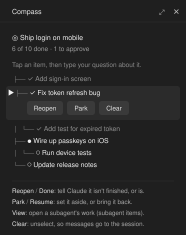
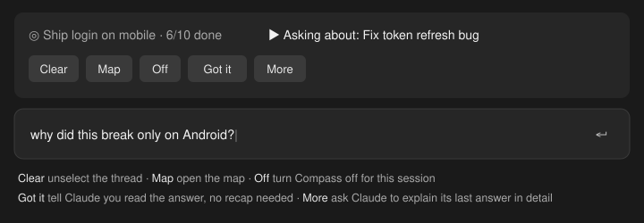

# Compass

A mod for Claude Code that keeps a long session on its goal and saves you from reading long text. It maps the session as threads of work, and you can tap any thread to ask Claude about it, like replying to one message in a chat.


## Reply to any thread on the map

Tap an item on the map, then type. It works like replying to one message in a chat thread: Claude knows which piece of work you mean, even if it came up an hour ago and the conversation has moved on.

**1. Tap a thread.** It's highlighted and shows what you can do with it:



**2. Type your question.** The bar above the message box shows which thread you're asking about:




- No need to re-explain or scroll back. Tap **Fix token refresh bug** and ask *"why did this break?"*, and Claude answers about that fix.
- Follow-up work goes under the item you tapped. Tap **Wire up passkeys on iOS** and say *"also add Android"*, and the new work shows on the map as a child of that item, so related work stays together.
- Your message stays short. Compass adds a hidden line naming the selected item; you just type the question.

## What it does

- **Goal band.** A one-line goal and a progress count (done / total, how many steps wait for approval) sit above the prompt.
- **Map pane.** The work so far, drawn as a tree. **Stem** items are steps toward the goal. **Side** items are topics that forked off it. Each item is *todo*, *working*, *done* or *parked*. Subagents show up as items by themselves.
- **Live mapping.** After each reply, and every so often during a long turn, a small model reads what was said since the last update and redraws the map. A goal you set yourself and items you parked stay as you left them.
- **Drift check.** When a message starts something unrelated to the goal, Claude adds it as a side item and asks "park it or go?" before starting it.
- **Short answers.** Claude opens every reply with at most three short lines: what happened, and what's next or what it needs.
- **Approve ahead.** Claude lists the steps that will need your approval under *Coming up*. You can approve them while it works, so the step runs without a prompt later. An approval covers one exact command prefix or one folder.
- **Tap to ask.** Tap any item and type to reply to that thread (see above).

## Safety rules

- Risky steps never get an Approve button: push, force, `rm -r`, `reset --hard`, deploy, publish, release, merge, `sudo`, `curl`, `wget`, payments, `.env`, secrets, credentials, passwords and tokens always go through the normal permission prompt.
- An approved command prefix never covers a chained or redirected command (`&&`, `;`, `|`, `>`).
- An approval only turns an "ask" into an "allow". It never overrides a deny, and it does nothing while Compass is off.
- A bare name like `src` approves only that path, not every `src` folder on disk.
- Subagents can't change the map.

## What Compass reads, sends and decides

Compass has no server and makes no network calls of its own. Everything it sends goes to Claude, through Claude Code's own model calls, under your existing account.

**What it reads**
- The conversation in the current session (your messages, Claude's replies, and the names of tools Claude used), to draw the map. Compass skips subagent messages and its own `[Compass]` notes.
- Its own saved state for the session (goal, map, steps) and one saved setting: whether new sessions start with Compass on.

**What it sends to a model**
- **Map drawing.** After each reply, and about every 2 minutes during a long turn, Compass sends the current goal, the map, and an excerpt of what was said since the last update (each message cut to 500 characters, at most 8,000 characters in all) to Claude Haiku. Haiku answers with the updated map as JSON. When you open the map or tap **Map so far**, Compass asks a fork of the session, with no tools, to draw the map from the conversation instead. On a reopened session with nothing to fork, it sends Haiku an excerpt of the saved conversation.
- Nothing is sent anywhere else, and the map stays inside the session.

**What it adds to your prompts**
- **Rules for Claude** (`prompt.compose`): while Compass is on, it adds one fixed block of instructions to the session's system prompt: keep the map current, flag side topics, list steps that need approval, and keep replies short. You can read the full text in `RULES` in `hooks/register.tsx`.
- **The selected thread** (`prompt.submit`): when an item is selected on the map, Compass adds one hidden line to your message: `[Compass] The person selected the step "<title>" (<status>) in the map: this message is about it.` Your own text isn't changed.
- **Button presses**: **More** sends the message *"Explain your last answer in more detail."* as you. Item buttons (Reopen, Done, Park, Resume) and **Got it** add one short note to the conversation telling Claude what you pressed, for example `Parked: "<title>". Don't work on it now.`

**What it decides**
- **Permissions** (`tool.check`): Compass runs after your own permission rules. It only steps in when the answer would be "ask", and changes it to "allow" only for a step you approved ahead in the pane. It never changes a "deny", never applies to risky steps (see Safety rules above), and doesn't run while Compass is off. Each run it allows is listed in the pane.
- **Its own tool** (`mcp__compass__update`): Compass registers this tool so Claude can update the map, and answers the calls itself. It handles no other tool. Calls from subagents are refused without changing anything.
- **Subagents** (`agent.spawn`): when Claude starts a subagent, Compass adds it to the map. It never changes or blocks the subagent. **View** on a subagent item opens that subagent's transcript in the app.
- **Scheduled sessions**: a session started by a scheduled task stays off unless you turn Compass on.

## Commands

| Command | What it does |
|---|---|
| `/compass` | Open the map pane |
| `/compass map` | Redraw the map from the conversation so far |
| `/compass goal <text>` | Set the goal yourself (automatic mapping won't change it) |
| `/compass on` / `off` | Turn Compass on or off for this session |
| `/compass default on` / `default off` | Choose whether new sessions start with Compass on |
| `/compass reset` | Clear the goal, map and steps |

New sessions start with Compass off unless you run `/compass default on`. Sessions started by a scheduled task stay off unless you turn it on.

## Install

Compass is a Claude Code plugin with a hooks module, so it needs a Claude Code build that supports mods. The map pane shows in the desktop app's Code tab.

Where an organization manages Claude Code, the short-answer rules and the "asking about" line only run if the organization lists Compass in its managed settings.

```
/plugin marketplace add abhilashkusuma52/compass
/plugin install compass@local-mods
```

## Develop

- `hooks/register.tsx`: the whole mod (band, pane, tool, hooks, live mapping)
- `types/index.d.ts`: the shapes of the saved state
- `tests/`: unit tests and scenario tests (approvals, mapping, commands)

## License

MIT. See [LICENSE](LICENSE).
